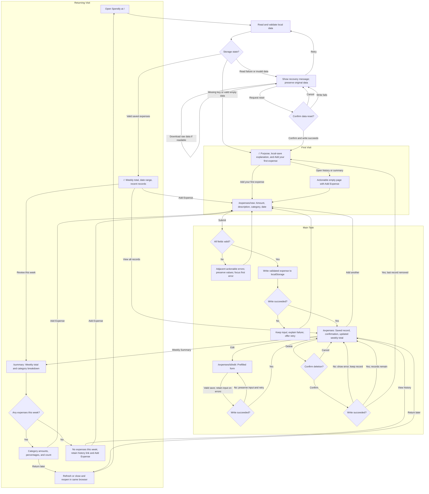

# Spendly

A simple personal expense tracker: record everyday purchases quickly and understand where your money goes each week.

## Project status

**Phase 6: weekly spending review and returning experience.** Add, edit and delete saved purchases; review this week's total, categories, percentages and counts; return to recent expenses and older history. Data is stored locally in this browser. Invalid data opens recovery without silent overwrites. Deployment and the live agent first-run check remain Phase 7 and require confirmation. Actual browser lifecycle and visual/accessibility checks remain unverified in this session.

Stack: Next.js App Router, React, TypeScript, Tailwind CSS, and ESLint. Data is saved in browser localStorage. No accounts, database, backend services, or external runtime APIs.

## Who it is for and why they return

Spendly is for an individual tracking everyday purchases on one device. The daily task is quick manual expense entry. The weekly return value is seeing category totals and understanding where recorded money went. Saved history stays available in the same browser, even when the current week has no entries.

## Core user flow

I record an expense -> I immediately see the record and updated total -> I come back a few days later -> my history remains and I can review this week's spending by category.



See [flow details and exceptional states](flows.md) and the [product brief](docs/product.md).

## Available pages

| Route | Current experience |
| --- | --- |
| `/` | Loading/recovery, first visit, or saved-data overview with weekly total |
| `/expenses/new` | Validated form that saves only after a successful local write |
| `/expenses` | Saved history, this week's total, edit/delete, and an actionable empty state |
| `/summary` | Weekly category amounts, percentages, counts, leading-category insight and honest empty-week state |
| `/expenses/[id]/edit` | Prefilled edit form or a clear missing-record state |

Shared navigation connects Overview, Expenses, Weekly Summary, and Add Expense. The form uses amount (USD), a short description, category, and date; date defaults to today. Weeks run Monday-Sunday using local dates. The app reads and validates browser storage before showing a first visit or saved-data view. Successful writes update the saved record and weekly total immediately. The weekly category view is implemented. Returning home shows three recent saved expenses, and old history stays reachable when this week is empty. Focus/visibility and a minute check update the local reporting day when returning to an open tab.

## Competitor onboarding research

Three actual independent subagents researched one product each on October 18, 2026. The findings use live public official sources and documented onboarding; no authenticated app walkthrough or completion-time measurement was performed.

| Product | Documented initial experience | Lesson for Spendly |
| --- | --- | --- |
| [Spendee research](docs/research/spendee.md) | Registration, bank-connection promotion, a manual transaction route, and category overviews | Keep a prominent add action and connect entries to spending feedback; skip account/bank setup |
| [Wallet research](docs/research/wallet.md) | Registration and currency selection; a default cash account; manual records and statistics | Make defaults clear and provide useful category feedback without account/widget setup |
| [Goodbudget research](docs/research/goodbudget.md) | Envelope-based overview; the guide teaches budget/account/income setup before expenses | Make history and category review easy to reach; omit budgeting setup before the first record |

Read the [research synthesis and design decisions](docs/research/README.md) for evidence limits and which recommendations were adopted or adjusted.

## Seven delivery phases

1. Product definition, three independent competitor studies, flows, and project instructions.
2. Next.js/Tailwind foundation and shared UI/navigation.
3. Actionable first-visit experience.
4. Expense form, validation, and feedback.
5. localStorage persistence, history, edit/delete, and storage edge cases.
6. Weekly review, returning experience, and accessibility checks.
7. Vercel deployment, actual online agent first-run check, fixes, and final evidence.

Each phase has a meaningful checked commit. See [phase plan and exact commit messages](docs/phase-plan.md). The repository initialization commit predates these seven milestones.

## Local development

Use Node.js 24+ and npm. The lockfile records the installed versions.

```bash
npm ci
npm run dev
```

Open http://localhost:3000. Add expenses, view saved history and weekly category review, or edit/delete existing records. Data is confined to this browser profile and origin; localhost and a future Vercel site do not share data.

```bash
npm test
npm run typecheck
npm run lint
npm run build
npm run start
```

The typecheck command generates Next.js route types before running TypeScript, including on a fresh checkout. Scripts use Next.js's supported Webpack bundler because this execution environment blocks Turbopack's internal worker port. The production build does not fetch fonts or call external APIs.

Tests use Node's built-in runner, tsx for TSX, and jsdom for a simulated DOM. These are development-only tools; simulated DOM tests do not replace browser or deployed usability checks.

Read the [design system](docs/design-system.md) for colors, type, spacing, responsive behavior, and component contracts. The phase review records tooling compatibility and dependency-audit limitations.

## Verification and persistence

See the [verification plan](docs/verification.md), [Phase 5 evidence](docs/phase-5-review.md), and [Phase 6 evidence](docs/phase-6-review.md). `npm test` covers validation, storage schema and failures, real-component DOM behavior, edit/delete/reset, and cross-runtime file-backed Web Storage. Actual browser refresh and close/reopen remain **unverified** because no browser connection was available. Provider remount and Node process tests are not substitutes for that browser check.

Data stays in this browser profile and site origin. It does not sync across devices, and clearing site data removes it. Writes complete before success feedback. Invalid JSON, unsupported versions, invalid records and duplicate ids enter recovery; the raw value is retained. Recovery offers retry, a local raw download, and a separately confirmed reset. Conflicting external changes reject stale writes. Form-specific reload failures preserve typed values.

Weekly analysis includes only recorded purchases in the displayed Monday-Sunday date range. Percentages are rounded to one decimal; tiny positive shares display `<0.1%`, and totals may differ slightly from 100%. Tied leading categories are identified as ties. No sample expenses or unsupported comparisons are shown.

Earlier evidence: [Phase 1](docs/phase-1-review.md), [Phase 2](docs/phase-2-review.md), [Phase 3](docs/phase-3-review.md), and [Phase 4](docs/phase-4-review.md).

## Deployed agent first-run check

**Not yet run: pending Phase 7 implementation and deployment.**

The agent must actually open the live Vercel site as a new user, add three purchases, correct a form error, verify records and totals, inspect the weekly category distribution, refresh, and separately close/reopen the site to verify returning data. Record the actual URL, test date, browser/profile, findings, changes, and retest results here. No feedback or fixes are claimed yet.

## Submission links

- GitHub: [YitingChen-coder/spendly](https://github.com/YitingChen-coder/spendly)
- Vercel: not deployed; live URL will be recorded in Phase 7.

## Project documentation

- [Project instructions](AGENTS.md)
- [Product scope and data decisions](docs/product.md)
- [Design system and shared components](docs/design-system.md)
- [Phase 2 implementation plan](docs/phase-2-plan.md)
- [Phase 2 verification](docs/phase-2-review.md)
- [Phase 3 first-visit plan](docs/phase-3-plan.md)
- [Phase 3 verification](docs/phase-3-review.md)
- [Phase 4 form plan](docs/phase-4-plan.md)
- [Phase 4 verification](docs/phase-4-review.md)
- [Phase 5 persistence plan](docs/phase-5-plan.md)
- [Phase 5 verification](docs/phase-5-review.md)
- [Phase 6 weekly-review plan](docs/phase-6-plan.md)
- [Phase 6 verification](docs/phase-6-review.md)
- [Detailed flows](flows.md)
- [Research synthesis](docs/research/README.md)
- [Seven-phase plan](docs/phase-plan.md)
- [Acceptance and verification plan](docs/verification.md)
- [Phase 1 requirements review](docs/phase-1-review.md)

All project artifacts, interface copy, code/comments, and commits use English. User-agent discussion uses Chinese. Prepare to explain design choices, onboarding, retention, agent feedback, and the collaborative development process in class.
