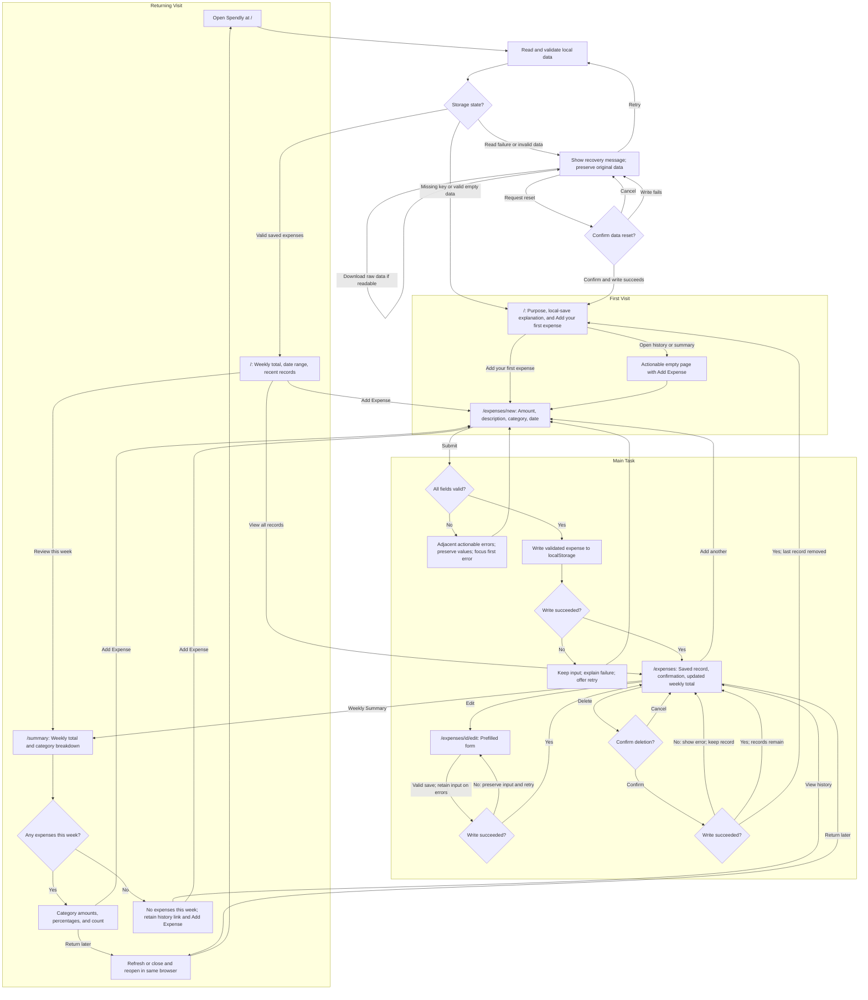

# Spendly

A simple personal expense tracker: record everyday purchases quickly and understand where your money goes each week.

## Project status

**Phase 4: expense form, validation, and temporary feedback.** Add purchases through the four-field form and view them during the current visit. Entries exist only in memory: refresh or close the page and they are cleared. localStorage, edit/delete, durable history, totals, and weekly calculations are not implemented. Phase 5 requires the user's confirmation. No Vercel deployment or deployed first-run check has been completed.

Stack: Next.js App Router, React, TypeScript, Tailwind CSS, and ESLint. Browser localStorage is planned for Phase 5. No accounts, database, backend services, or external runtime APIs.

## Who it is for and why they return

Spendly is for an individual tracking everyday purchases on one device. The daily task is quick manual expense entry. The weekly return value is seeing category totals and understanding where recorded money went. Saved history stays available in the same browser, even when the current week has no entries.

## Core user flow

I record an expense -> I immediately see the record and updated total -> I come back a few days later -> my history remains and I can review this week's spending by category.



See [flow details and exceptional states](flows.md) and the [product brief](docs/product.md).

## Available pages

| Route | Current experience |
| --- | --- |
| `/` | First-visit purpose, primary entry link, brief workflow, and local-data explanation |
| `/expenses/new` | Single-column expense form, field validation, and temporary submission |
| `/expenses` | This visit's temporary purchases and feedback, or an actionable empty state |
| `/summary` | Preview empty state with first-expense entry link |

The edit route `/expenses/[id]/edit` is planned for Phase 5 and is not available in this preview.

Shared navigation connects Overview, Expenses, Weekly Summary, and Add Expense. The form uses amount (USD), a short description, category, and date; date defaults to today. Weeks run Monday-Sunday using local dates. The shell, navigation, first-visit presentation, and expense form are implemented. Reporting rules remain planned. The home page does not inspect storage or distinguish returning users yet. New entries appear on Expenses with temporary feedback; no durable-save message or totals are shown.

## Competitor onboarding research

Three actual independent subagents researched one product each on October 18, 2026. The findings use live public official sources and documented onboarding; no authenticated app walkthrough or completion-time measurement was performed.

| Product | Documented initial experience | Lesson for Spendly |
| --- | --- | --- |
| [Spendee research](docs/research/spendee.md) | Registration, bank-connection promotion, a manual transaction route, and category overviews | Keep a prominent add action and connect entries to spending feedback; skip account/bank setup |
| [Wallet research](docs/research/wallet.md) | Registration and currency selection; a default cash account; manual records and statistics | Make defaults clear and provide useful category feedback without account/widget setup |
| [Goodbudget research](docs/research/goodbudget.md) | Envelope-based overview; the guide teaches budget/account/income setup before expenses | Make history and category review easy to reach; omit budgeting setup before the first record |

Read the [research synthesis and design decisions](docs/research/README.md) for evidence limits and which recommendations were adopted or adjusted.

## Seven delivery phases

1. Product definition, three independent competitor studies, flows, and project instructions.
2. Next.js/Tailwind foundation and shared UI/navigation.
3. Actionable first-visit experience.
4. Expense form, validation, and feedback.
5. localStorage persistence, history, edit/delete, and storage edge cases.
6. Weekly review, returning experience, and accessibility checks.
7. Vercel deployment, actual online agent first-run check, fixes, and final evidence.

Each phase has a meaningful checked commit. See [phase plan and exact commit messages](docs/phase-plan.md). The repository initialization commit predates these seven milestones.

## Local development

Use Node.js 24+ and npm. The lockfile records the installed versions.

```bash
npm ci
npm run dev
```

Open http://localhost:3000. The preview supports adding expenses for the current visit only. Navigate within the app to retain temporary entries. Refreshing or closing the page clears them.

```bash
npm test
npm run typecheck
npm run lint
npm run build
npm run start
```

The typecheck command generates Next.js route types before running TypeScript, including on a fresh checkout. Scripts use Next.js's supported Webpack bundler because this execution environment blocks Turbopack's internal worker port. The production build does not fetch fonts or call external APIs.

Tests use Node's built-in runner, tsx for TSX, and jsdom for a simulated DOM. These are development-only tools; simulated DOM tests do not replace browser or deployed usability checks.

Read the [design system](docs/design-system.md) for colors, type, spacing, responsive behavior, and component contracts. The phase review records tooling compatibility and dependency-audit limitations.

## Verification and persistence

See the [verification plan](docs/verification.md) for required refresh and close/reopen checks, missing/empty/invalid/corrupt storage cases, storage failures, form validation, calculations, and accessibility. Expense validation and simulated-DOM interaction tests run with `npm test`. Persistence tests remain pending Phase 5. Phase 2 checks cover TypeScript, ESLint, a production build, HTTP responses for all four routes, component semantics, and calculated color contrast. See [Phase 2 verification](docs/phase-2-review.md) [Phase 3 verification](docs/phase-3-review.md), and [Phase 4 verification](docs/phase-4-review.md) for actual results and limitations. [Phase 1 review](docs/phase-1-review.md) records the earlier documentation audit.

At this milestone, data is temporary in memory and is lost on refresh/close. In Phase 5, saved data will remain local to the current browser profile and site origin; it will not sync between devices or between localhost and Vercel. Invalid storage must not be silently overwritten. No sample expenses will be represented as the user's saved data.

## Deployed agent first-run check

**Not yet run: pending Phase 7 implementation and deployment.**

The agent must actually open the live Vercel site as a new user, add three purchases, correct a form error, verify records and totals, inspect the weekly category distribution, refresh, and separately close/reopen the site to verify returning data. Record the actual URL, test date, browser/profile, findings, changes, and retest results here. No feedback or fixes are claimed yet.

## Submission links

- GitHub: [YitingChen-coder/spendly](https://github.com/YitingChen-coder/spendly)
- Vercel: not deployed; live URL will be recorded in Phase 7.

## Project documentation

- [Project instructions](AGENTS.md)
- [Product scope and data decisions](docs/product.md)
- [Design system and shared components](docs/design-system.md)
- [Phase 2 implementation plan](docs/phase-2-plan.md)
- [Phase 2 verification](docs/phase-2-review.md)
- [Phase 3 first-visit plan](docs/phase-3-plan.md)
- [Phase 3 verification](docs/phase-3-review.md)
- [Phase 4 form plan](docs/phase-4-plan.md)
- [Phase 4 verification](docs/phase-4-review.md)
- [Detailed flows](flows.md)
- [Research synthesis](docs/research/README.md)
- [Seven-phase plan](docs/phase-plan.md)
- [Acceptance and verification plan](docs/verification.md)
- [Phase 1 requirements review](docs/phase-1-review.md)

All project artifacts, interface copy, code/comments, and commits use English. User-agent discussion uses Chinese. Prepare to explain design choices, onboarding, retention, agent feedback, and the collaborative development process in class.
