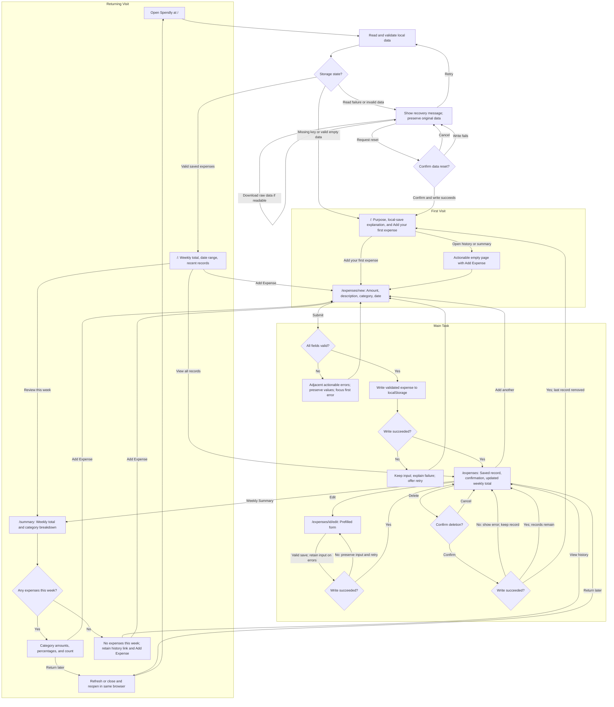

# Spendly

A simple personal expense tracker: record everyday purchases quickly and understand where your money goes each week.

## Project status

**Phase 7: deployed, remote agent test report recorded, floating guide added.** Spendly is live on Vercel's free Hobby plan at [spendly-nu-liard.vercel.app](https://spendly-nu-liard.vercel.app). A user-supplied report from a separate Codex session records successful deployed Chromium first-run, recovery and persistence checks. The report is incorporated below with provenance and limitations; screenshot synchronization and the remaining manual checks are still outstanding.

Stack: Next.js App Router, React, TypeScript, Tailwind CSS, and ESLint. Data is saved in browser localStorage. No accounts, database, backend services, or external runtime APIs.

## Who it is for and why they return

Spendly is for an individual tracking everyday purchases on one device. The daily task is quick manual expense entry. The weekly return value is seeing category totals and understanding where recorded money went. Saved history stays available in the same browser, even when the current week has no entries.

## Flow planning

The user and agent defined Spendly's First Visit, Main Task and Returning Visit before implementation, then delivered the product through seven staged milestones. The plan covers routes, validation, successful saves, storage failures, empty states and weekly return value. See the [detailed user flows](flows.md), [seven-phase delivery plan](docs/phase-plan.md) and [final flow review](docs/final-flow-review.md). The user reviewed and accepted this planning work as complete.

## Core user flow

I record an expense -> I immediately see the record and updated total -> I come back a few days later -> my history remains and I can review this week's spending by category.



See [flow details and exceptional states](flows.md) and the [product brief](docs/product.md).

## Floating quick-start guide

On the first visit, a floating Quick guide introduces adding an expense, viewing records and reviewing the week. Next/Back, Skip, Close and Done controls keep it optional; the final step links directly to expense entry. The launcher reopens it at any time. Dismissal uses a separate `spendly:quick-guide:v1` localStorage key and never modifies expense records. If storage is unavailable, dismissal lasts for the current page session. The non-modal panel supports Escape, visible focus and focus return when closed from inside; automatic display does not move focus.

Guide interactions, dismissal/remount, replay and denied-storage behavior are covered by component tests. The earlier remote browser report predates this addition and does not validate the new guide in a deployed browser. A subsequent remote Chromium attempt was blocked by proxy CONNECT 403 before production interactions; guide behavior, keyboard navigation and viewport overlap checks remain unverified. GitHub asset blocking also prevented visual Mermaid confirmation.

## Available pages

| Route | Current experience |
| --- | --- |
| `/` | Loading/recovery, first visit, or saved-data overview with weekly total |
| `/expenses/new` | Validated form that saves only after a successful local write |
| `/expenses` | Saved history, this week's total, edit/delete, and an actionable empty state |
| `/summary` | Weekly category amounts, percentages, counts, leading-category insight and honest empty-week state |
| `/expenses/[id]/edit` | Prefilled edit form or a clear missing-record state |

Shared navigation connects Overview, Expenses, Weekly Summary, and Add Expense. The form uses amount (USD), a short description, category, and date; date defaults to today. Weeks run Monday-Sunday using local dates. The app reads and validates browser storage before showing a first visit or saved-data view. Successful writes update the saved record and weekly total immediately. The weekly category view is implemented. Returning home shows three recent saved expenses, and old history stays reachable when this week is empty. Focus/visibility and a minute check update the local reporting day when returning to an open tab.

## Competitor onboarding research

Three actual independent subagents researched one product each on October 18, 2026. The findings use live public official sources and documented onboarding; no authenticated app walkthrough or completion-time measurement was performed.

| Product | Documented initial experience | Lesson for Spendly |
| --- | --- | --- |
| [Spendee research](docs/research/spendee.md) | Registration, bank-connection promotion, a manual transaction route, and category overviews | Keep a prominent add action and connect entries to spending feedback; skip account/bank setup |
| [Wallet research](docs/research/wallet.md) | Registration and currency selection; a default cash account; manual records and statistics | Make defaults clear and provide useful category feedback without account/widget setup |
| [Goodbudget research](docs/research/goodbudget.md) | Envelope-based overview; the guide teaches budget/account/income setup before expenses | Make history and category review easy to reach; omit budgeting setup before the first record |

Read the [research synthesis and design decisions](docs/research/README.md) for evidence limits and which recommendations were adopted or adjusted.

## Seven delivery phases

1. Product definition, three independent competitor studies, flows, and project instructions.
2. Next.js/Tailwind foundation and shared UI/navigation.
3. Actionable first-visit experience.
4. Expense form, validation, and feedback.
5. localStorage persistence, history, edit/delete, and storage edge cases.
6. Weekly review, returning experience, and accessibility checks.
7. Vercel deployment, actual online agent first-run check, fixes, and final evidence.

Each phase has a meaningful checked commit. See [phase plan and exact commit messages](docs/phase-plan.md). The repository initialization commit predates these seven milestones.

## Local development

Use Node.js 24.x and npm. The lockfile records the installed versions. The Node major is pinned to match the verified local and Vercel runtime.

```bash
npm ci
npm run dev
```

Open http://localhost:3000. Add expenses, view saved history and weekly category review, or edit/delete existing records. Data is confined to this browser profile and origin; localhost and a future Vercel site do not share data.

```bash
npm test
npm run typecheck
npm run lint
npm run build
npm run start
```

The typecheck command generates Next.js route types before running TypeScript, including on a fresh checkout. Scripts use Next.js's supported Webpack bundler because this execution environment blocks Turbopack's internal worker port. The production build does not fetch fonts or call external APIs.

Tests use Node's built-in runner, tsx for TSX, and jsdom for a simulated DOM. These are development-only tools; simulated DOM tests do not replace browser or deployed usability checks.

Read the [design system](docs/design-system.md) for colors, type, spacing, responsive behavior, and component contracts. The phase review records tooling compatibility and dependency-audit limitations.

## Verification and persistence

See the [verification plan](docs/verification.md), [Phase 5 evidence](docs/phase-5-review.md), and [Phase 6 evidence](docs/phase-6-review.md). `npm test` covers validation, storage schema and failures, real-component DOM behavior, edit/delete/reset, and cross-runtime file-backed Web Storage. A user-supplied remote Codex report records successful deployed Chromium refresh, tab reopen and full browser restart checks in the same persistent profile; see the first-run report below. The current local session did not independently repeat them. Provider remount and Node process tests remain separate evidence.

Data stays in this browser profile and site origin. It does not sync across devices, and clearing site data removes it. Writes complete before success feedback. Invalid JSON, unsupported versions, invalid records and duplicate ids enter recovery; the raw value is retained. Recovery offers retry, a local raw download, and a separately confirmed reset. Conflicting external changes reject stale writes. Form-specific reload failures preserve typed values.

Weekly analysis includes only recorded purchases in the displayed Monday-Sunday date range. Percentages are rounded to one decimal; tiny positive shares display `<0.1%`, and totals may differ slightly from 100%. Tied leading categories are identified as ties. No sample expenses or unsupported comparisons are shown.

Earlier evidence: [Phase 1](docs/phase-1-review.md), [Phase 2](docs/phase-2-review.md), [Phase 3](docs/phase-3-review.md), and [Phase 4](docs/phase-4-review.md).

## Deployed agent first-run check

**Reported as executed on October 19, 2026 against https://spendly-nu-liard.vercel.app.** An agent used Playwright to control actual headless Chromium 154.0.8037.57 with a fresh, isolated persistent profile and the America/Chicago timezone. This was a deployed-site interaction test, separate from the Node/jsdom suite and the user's personal browser session. The test began with no saved expenses.

**Evidence source:** The user supplied this report from a separate remote Codex session. The current local session did not rerun these browser actions or inspect its screenshots. The reported deployment commit was not independently identified.

### Agent usability feedback

| Task and observation | Agent feedback | Action and result |
| --- | --- | --- |
| First visit exposed “Add your first expense” without account setup. | The first action was identifiable through its visible name and could be followed immediately. | Kept the existing onboarding; the first-visit action and real form submissions passed. No completion time was measured. |
| Submitting an empty form showed field errors and focused the amount input. Subsequent completed submissions succeeded. | Validation provides a route to correction instead of leaving the user without a next step. | Kept current validation; error feedback and first-error focus passed. |
| Three purchases produced a $40.00 total and category amounts, counts and percentages. | Recording an expense leads to visible spending feedback, supporting the product's reason to return. | Verified the exact amounts and shares below; no calculation fix was needed. |
| Refresh, reopening a tab and restarting Chromium retained the same saved value. | The returning experience worked in the tested profile, consistent with the local-save explanation. | Verified all three lifecycle steps on the deployed origin. No persistence fix was needed. |
| The weekly summary had no horizontal overflow at 375, 768 and 1280px; its 375px screenshot was inspected. | The narrow summary kept navigation, amounts, category labels and actions readable. | Retained the layout. This does not establish usability of every page or device. |
| Invalid stored data remained unchanged; a simulated storage-write failure preserved form input and existing records. | Recovery and failure feedback avoid falsely telling the user that data was saved or replacing unreadable records. | Recovery, cancel/reset and write-failure checks passed. No recovery fix was needed. |

### Steps, outcomes and follow-up

1. Opened the live site as a new user, followed the add flow, submitted an invalid form and then completed valid entries.
2. Added **$12.50 Food & Drink**, **$20.00 Groceries** and **$7.50 Transport**. Expected and actual total: **$40.00**; category shares: **31.3%, 50% and 18.8%**. Stored amounts were integer cents totaling 4000.
3. Refreshed, closed/reopened a tab, and closed/restarted Chromium with the same profile. The exact saved records remained after each step.
4. Edited $12.50 to $15.00: total became **$42.50**. Canceled deletion and verified focus returned and data stayed unchanged; then confirmed deletion of the $7.50 entry: total became **$35.00**.
5. Checked three summary viewport widths, malformed JSON, an unsupported storage version, reset cancellation, confirmed reset and an injected quota/write failure. All selected assertions passed; no uncaught browser page errors were observed.

**Changes after feedback:** Updated this README's stale deployment/test status, added the live submission link and incorporated the supplied test report. Screenshot files have not been synchronized to this local repository. No application defect was found in the exercised tasks, so no application code change or post-fix application retest is claimed. This is an automated agent usability check, not feedback from human study participants.

**Limits:** Manual screen-reader use, comprehensive keyboard navigation, all mobile forms and Safari/Firefox remain untested. The deployed commit was not independently identified. Initial environment proxy/certificate failures were resolved before the successful browser run; they were not application defects. See [the detailed run and cleanup record](docs/phase-7-review.md). The remote report states that screenshots were captured at 375, 768 and 1280px and the 375px image was visually inspected; the image files are not available in this local checkout.

## Submission links

- GitHub: [YitingChen-coder/spendly](https://github.com/YitingChen-coder/spendly)
- Vercel: [Spendly live application](https://spendly-nu-liard.vercel.app)

## Project documentation

- [Project instructions](AGENTS.md)
- [Product scope and data decisions](docs/product.md)
- [Design system and shared components](docs/design-system.md)
- [Phase 2 implementation plan](docs/phase-2-plan.md)
- [Phase 2 verification](docs/phase-2-review.md)
- [Phase 3 first-visit plan](docs/phase-3-plan.md)
- [Phase 3 verification](docs/phase-3-review.md)
- [Phase 4 form plan](docs/phase-4-plan.md)
- [Phase 4 verification](docs/phase-4-review.md)
- [Phase 5 persistence plan](docs/phase-5-plan.md)
- [Phase 5 verification](docs/phase-5-review.md)
- [Phase 6 weekly-review plan](docs/phase-6-plan.md)
- [Phase 6 verification](docs/phase-6-review.md)
- [Phase 7 deployment plan](docs/phase-7-plan.md)
- [Phase 7 deployment and pending browser check](docs/phase-7-review.md)
- [Final flow source review and process limitations](docs/final-flow-review.md)
- [Submission checklist](docs/submission-checklist.md)
- [Class presentation notes](docs/presentation-notes.md)
- [Detailed flows](flows.md)
- [Research synthesis](docs/research/README.md)
- [Seven-phase plan](docs/phase-plan.md)
- [Acceptance and verification plan](docs/verification.md)
- [Phase 1 requirements review](docs/phase-1-review.md)

All project artifacts, interface copy, code/comments, and commits use English. User-agent discussion uses Chinese. Prepare to explain design choices, onboarding, retention, agent feedback, and the collaborative development process in class.
