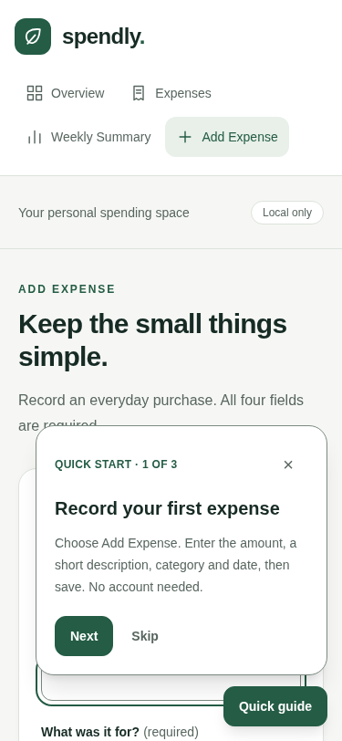
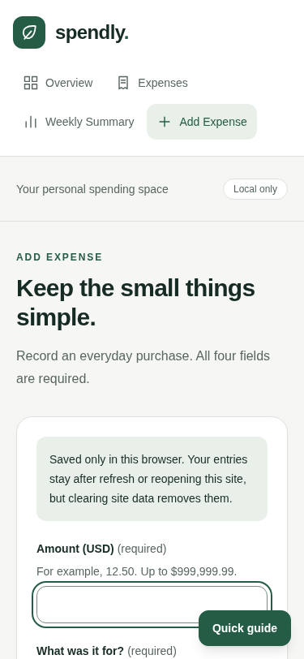
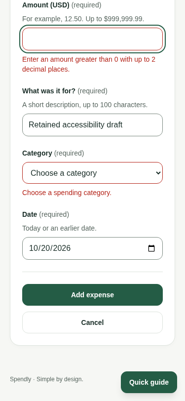

# Final accessibility audit — October 20, 2026

## Scope and environment

Source review plus actual Playwright-controlled Chromium 154.0.8037.57 against the local production build. Browser contexts were isolated, America/Chicago timezone, 375×812 viewport. This audit did not access personal data, deploy an update, or validate the fix on the hosted Vercel site. Earlier online acceptance remains separate evidence. No full WCAG conformance claim is made.

## Steps and findings

1. **Main navigation and shared controls — checked.** Reviewed Button, Input, FormField, SelectField, Navigation and global focus styles. Buttons use native button semantics and default to type=button; the expense action explicitly submits. Inputs/selects retain native semantics; wrappers provide actual HTML labels, required state, hints, error references and aria-invalid. The shared props include native attributes/ref support. Browser checks found four labeled required expense fields, one h1, English document language, no broken description references, and one current-page navigation link on each of Overview, Add Expense, Expenses, Weekly Summary, existing-record edit and missing-record edit. Native disabled prop/style handling was source-reviewed; disabled/loading controls were not separately exercised in this browser run.
2. **Keyboard and focus — confirmed defect, fixed and retested.** With the first-visit guide open on the mobile expense form, Tab moved focus to controls behind the floating panel. Center-point hit testing identified occluded amount/category/date/submit controls; the date field and submit button were entirely covered by the panel at the observed positions. [Before screenshot](02-amount-keyboard-focus-before.png) and [initial focus trace](initial.json). The guide now collapses for the current session when focus enters main, leaving focus on the task. It does not permanently mark the guide dismissed or touch expense records; its launcher can reopen it. A regression test failed before the fix and passed afterward. Browser retest found no center-point occlusion in the recorded 18-stop keyboard sequence. [After screenshot](04-amount-keyboard-focus-after.png).
3. **Validation and focus return — checked.** Invalid submission focused Amount, set aria-invalid, preserved the entered description, and linked field hints/errors to existing DOM elements. [Validation screenshot](05-validation-focus-after.png). Manual guide opening focused its heading; Escape returned focus to the launcher. Delete confirmation focused Confirm delete; cancellation returned focus to its delete trigger. A separate keyboard-only run used Tab/Enter for the skip link and Add Expense route, typed the fields, selected a category, and submitted a real $1.25 test expense. [Keyboard submit](keyboard-submit-focus.png), [saved record](keyboard-saved.png).
4. **Visible focus — checked with native-control qualification.** Input/select, links and buttons displayed outlines on keyboard focus. Browser transitions were allowed to settle before the final trace. The skip link became visible and Enter focused main. Chromium's native date segments used the outer focus ring; its calendar indicator used a native black inner focus rectangle instead of the input's outer outline. This was visually inspected in [the native calendar screenshot](06-native-date-picker-focus.png). The document body stop after tabbing out of controls is not an actionable control and is not counted as a missing control indicator. The fixed launcher still partially overlaps some content at certain scroll positions; the recorded focused controls were not entirely hidden after the panel fix. This is not a claim of zero overlap at every viewport.
5. **Text contrast — measured.** Collected computed foregrounds, inherited opaque/composited ancestor backgrounds, text size and weight for 348 text samples across validation, six routes, guide, primary hover, delete confirmation and corrupt-storage recovery. Used WCAG relative luminance and unrounded comparisons: normal text ≥4.5:1; large text ≥3:1 (24px, or at least 18.667px bold). Zero sampled failures; minimum 5.611:1. [Full computed evidence](final.json). Text and native input/select values were included; hidden options and disabled controls were excluded. Gradients, imagery, user styles, forced colors and native picker popup text were not evaluated by this calculation. Placeholder-only, secondary-hover and every transient loading state were not independently sampled.

## Representative measured text pairs

| Foreground / background | Contrast | Outcome |
| --- | --- | --- |
| Muted #58665f / canvas #f6f7f4 | 5.61:1 | Passes normal-text AA |
| Muted #58665f / white | 6.03:1 | Passes normal-text AA |
| Brand #245c45 / brand-soft #e8f0e9 | 6.71:1 | Passes normal-text AA |
| White / brand #245c45 | 7.80:1 | Passes normal-text AA |
| Danger #b42318 / white | 6.57:1 | Passes normal-text AA |
| Ink #172b25 / canvas #f6f7f4 | 13.86:1 | Passes normal and large text AA |

All 348 samples met their applicable threshold, including samples classified as large text. No text colors or shared Button/Input APIs needed changing.

## Changes and verification

Only product behavior change: collapse the non-modal guide on main-task focus without moving focus, writing a permanent dismissal, or changing expense data. Added a real component regression test for that behavior and launcher reopening. During the first failing run, formatting a DOM assertion stalled; the assertion was changed to a boolean comparison, then the missing behavior produced the expected failing assertion. After implementation, the test passed.

The initial browser verification script assumed the guide was closed after a full navigation. It was actually auto-open because the new session-only collapse intentionally does not persist dismissal. The script explicitly closed it before testing manual reopening; this was a test-state correction, not another product defect.

- npm test: **132 passed, zero failed/skipped/canceled**, including the new regression.
- npm run typecheck: passed.
- npm run lint: passed with zero warnings.
- npm run build: passed.
- Actual Chromium keyboard, labels/references, navigation, error, focus-return and computed text-contrast checks above: passed for the specified cases after the fix.

## Limits

No NVDA/JAWS/VoiceOver use, Firefox/Safari, forced-colors mode, zoom/reflow assessment, all viewport sizes, exhaustive WCAG audit, or assistive-technology announcement testing was performed. ARIA/live-region markup and references were inspected, but spoken announcements were not heard. This fix is verified on the local production build only; no redeployment or online post-fix verification is claimed. The earlier agent-side GitHub Mermaid check was blocked. Newly integrated project documentation separately records subsequent user visual confirmation; this accessibility audit did not independently inspect that screenshot or repeat the Mermaid check.

## Visual evidence

### Before: keyboard focus behind the open guide

### After: guide collapsed and amount focus visible

### Validation: retained draft and actionable errors

