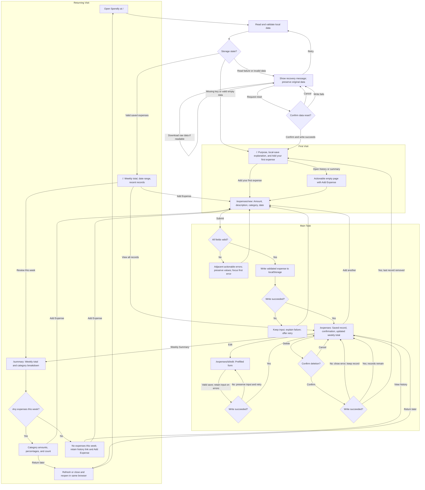

# Spendly User Flows

## Main task in one sentence

I record an expense -> I immediately see the record and updated total -> I come back a few days later -> my history remains and I can review this week's spending by category.

## Flow diagram

The same diagram is embedded in README.md so GitHub can display it directly.

## First Visit

Precondition: no saved expenses, either because the storage key is missing or the validated dataset is empty. Show purpose, a short local-data explanation, and a primary action to record the first expense. No registration, currency setup, required tour, or fabricated spending. Opening history/summary directly still gives an explanation and an add action. After entering and saving an expense, the user reaches the populated history page and sees their own first useful result.

## Main Task

The single-column form asks for amount, description, category, and date, defaulting date to today. Cancel returns to history without creating a record. Invalid submission preserves all values, displays field-specific guidance, and focuses the first error. A successful storage write precedes the saved confirmation and updated totals. Storage errors retain input and offer retry without a duplicate save. Corrections use a prefilled edit route with the same validation and failure behavior. Deletion requires confirmation and only updates the UI as saved when persistence succeeds. A missing edit id links back to history. Shared navigation provides an Overview route from every step.

## Returning Visit

Precondition: saved records in the same browser profile and origin. Read and validate storage before choosing the initial page state, avoiding an empty-state flash. Show current-week total and recent purchases, then let the user open all history or weekly category distribution. A week without expenses has an honest empty summary and still provides older history and the add action. Refresh and closing/reopening the site are separate persistence checks.

## Exceptional states

Do not treat loading or a storage read failure as a first visit. Malformed JSON, unsupported versions, and invalid records open recovery without overwriting data. Retry the read, download the original raw value if readable, or explicitly confirm a reset. Canceling reset keeps the original value. A reset write failure stays in recovery. Data is saved only in this browser; clearing site data or switching devices does not preserve it.

## Diagram maintenance

Keep the fenced Mermaid block here and in README.md identical. Small validation and navigation details are described in prose to keep the diagram readable.
